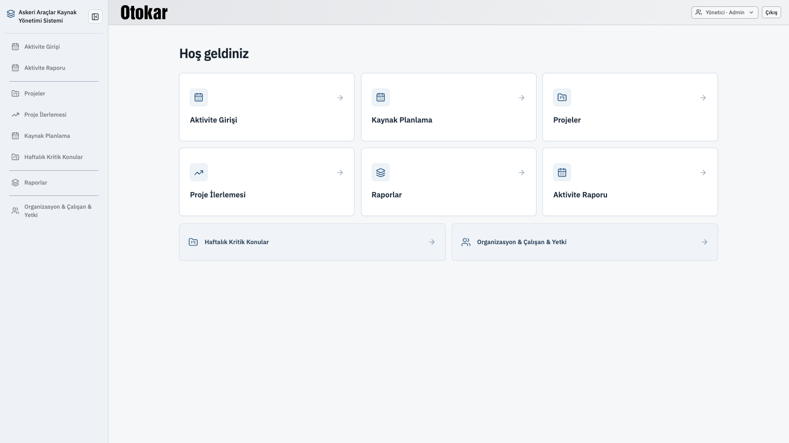

# Açılış ekranı tasarım örneği

Mevcut uygulamanın renklerini, üst barını ve sol menüsünü kullanan sade tasarım önerisi. İçerik alanında yalnızca “Hoş geldiniz” başlığı ve bölüm kartları bulunur.

Önerilen davranış:

- Varsayılan sekme seçilmemişse bu ekran açılır.
- Sol menüye ayrı bir açılış sekmesi eklenmez.
- Kullanıcının yetkili olduğu bölümler kart olarak gösterilir; kart seçimi ilgili sekmeyi açar.

